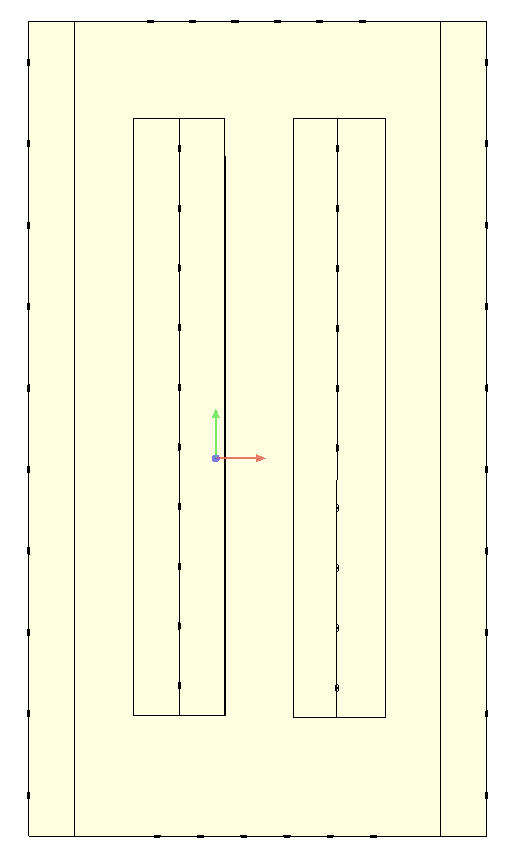
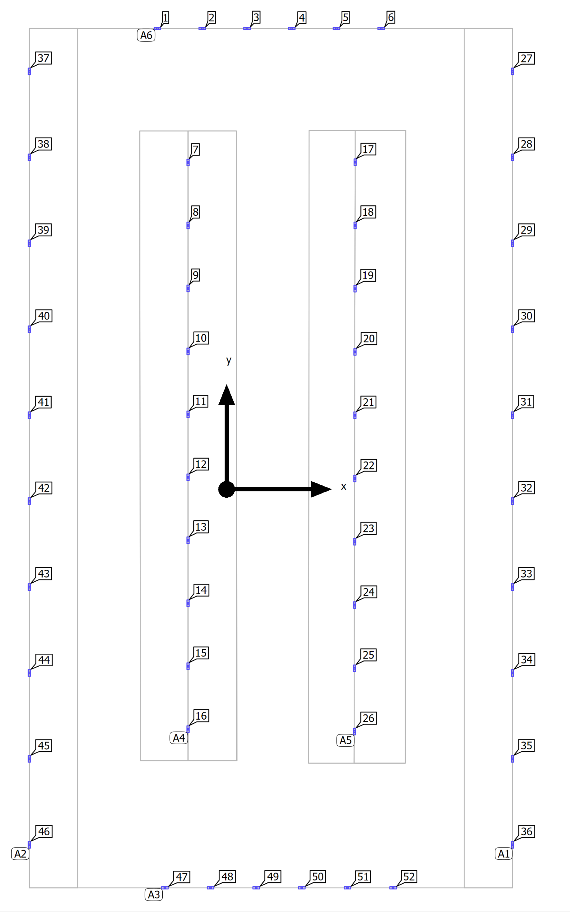
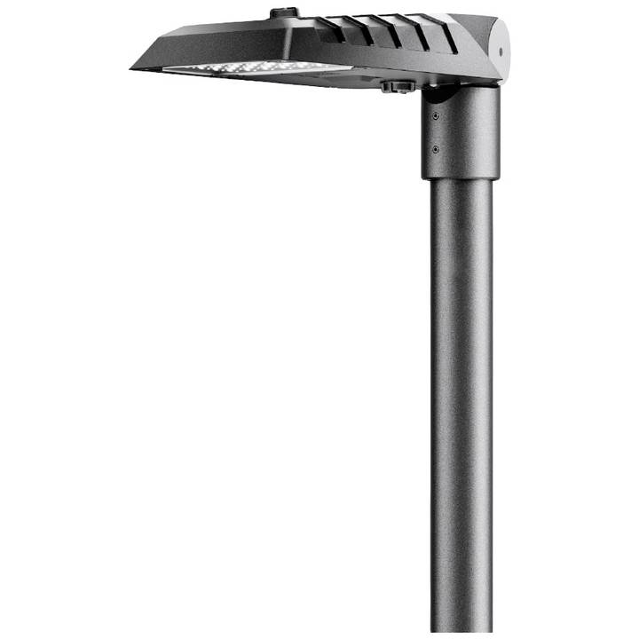
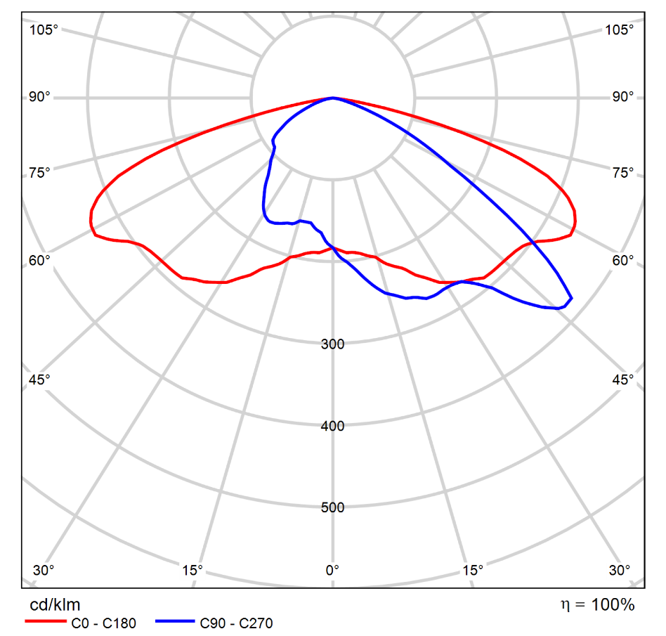
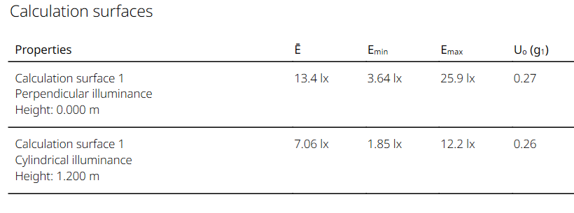
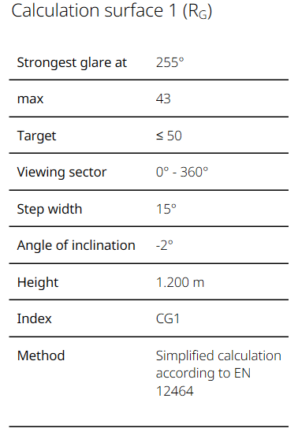

# Outdoor Car Park Lighting Design (DIALux evo)

Lighting design for an **80 × 45 m outdoor car park** (3,600 m²) serving a department store, classed as **medium traffic** under **EN 12464-2**. Modelled and verified in **DIALux evo**.

Course project for *Lighting Design of Public Spaces*, Warsaw University of Technology, 2026.

| Site plan | Luminaire layout (52 luminaires) |
|---|---|
|  |  |

## Design brief

- 80 × 45 m car park, symmetrical about both axes, with the road entrance on one side and the store entrance on the other
- Two central parking islands with perimeter driving lanes
- Medium-traffic category (office buildings, department stores)

### Requirements (EN 12464-2)

| Category | Ēm [lx] | U₀ | Glare limit RGL | Ra |
|---|---|---|---|---|
| Light traffic | 5 | 0.25 | 55 | 20 |
| **Medium traffic (this design)** | **10** | **0.25** | **50** | **20** |
| Heavy traffic | 20 | 0.25 | 50 | 20 |

## Luminaire

| Luminaire | Light distribution curve |
|---|---|
|  |  |

| Parameter | Value |
|---|---|
| Model | Trilux LIQ 50N-AB7L-1700-7302 1 06 (configured variant) |
| Luminous flux | 1700 lm |
| Power | 13.5 W |
| CCT | 3000 K |
| CRI | 70 |
| Quantity | 52 |
| Placement | Along the perimeter and in the two central islands |

## Results

| Quantity | Required | Achieved |
|---|---|---|
| Average horizontal illuminance Ē (ground level) | ≥ 10 lx | **13.4 lx** |
| Uniformity U₀ (horizontal) | ≥ 0.25 | **0.27** |
| Glare rating RGL (max) | ≤ 50 | **43** |
| Colour rendering Ra | ≥ 20 | **70** |
| Average cylindrical illuminance (1.2 m) | – | 7.06 lx (U₀ 0.26) |
| Installed power | – | 702 W (≈ 0.20 W/m²) |

| Calculation surfaces | Glare rating |
|---|---|
|  |  |

**The design meets every EN 12464-2 requirement for a medium-traffic car park.** It does so with 52 low-power (13.5 W) LED luminaires, about 0.2 W/m² installed.

## Files

| File | Content |
|---|---|
| [`Outdoor_Parking_Report.pdf`](Outdoor_Parking_Report.pdf) | Project report |
| `Outdoor_Parking.evo` | DIALux evo project file |
| `*.png` | Figures used in this README |

## Tools and skills

DIALux evo · EN 12464-2 (outdoor workplaces) · Outdoor and area lighting · Luminaire selection · Glare rating (RGL) analysis

## Author

**Nurmukhammed Polat**, Electrical Engineering, Warsaw University of Technology
[LinkedIn](https://www.linkedin.com/in/nurmukhammed-polat-6a6677251/)
